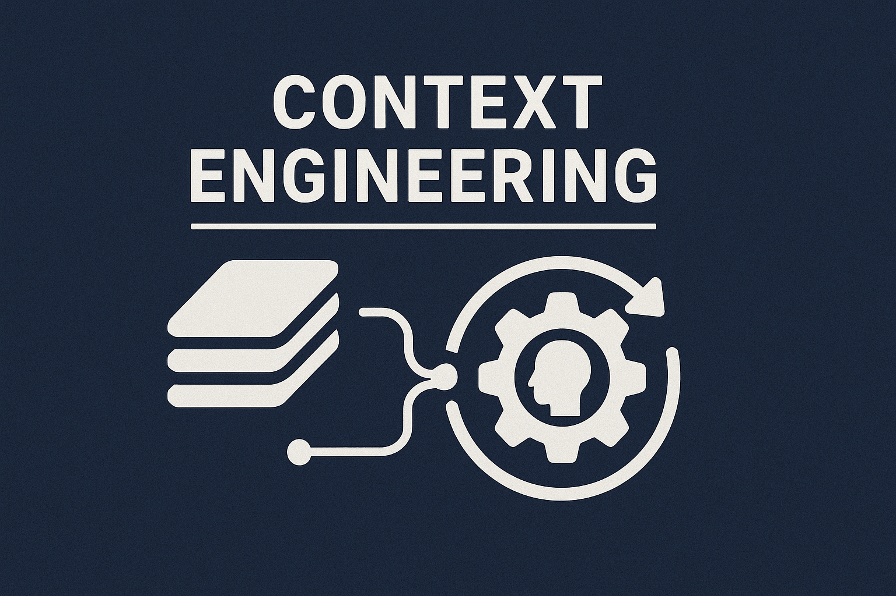

# Context Engineering

This repository provides a spec-driven approach to software engineering with agents' help
based on the Context Engineering principle. This approach works for
[Claude Code](https://docs.anthropic.com/en/docs/claude-code/overview) as well as
[Github Copilot in Visual Studio Code](https://code.visualstudio.com/docs/copilot/overview).

## What is context engineering?

If you've worked with GitHub Copilot or other coding agents before, you may have noticed
that getting the agent to write the code you want takes quite some effort. At first, you
may get the correct result, but the agent starts misbehaving after a while.

Coding agents work better with the correct information. Building the proper context for
a coding agent that contains all the necessary information is called context
engineering.

Context engineering is a systematic approach to optimizing AI agent performance in
software development tasks by strategically curating and structuring the information
provided to the agent. Rather than giving agents brief, ad-hoc instructions, context
engineering emphasizes deliberate preparation of a comprehensive context that enables
agents to produce higher-quality, more consistent results.

### Core Principles

The Context engineering approach in this repository is based on a few core principles:

- Layered Context Architecture
- Research-Driven Plan Generation
- Self-Validating Workflows

### Key Benefits

- **Higher Code Quality**: Agents have access to comprehensive context, including
  existing patterns, conventions, and architectural decisions
- **Documentation as a Byproduct**: Requirements documents serve as lasting project
  documentation
- **Reduced Iteration Cycles**: Well-researched context reduces the need for
  back-and-forth clarification
- **Consistency**: A Structured approach ensures consistent code quality across
  different features and team members

## Getting started

This repository provides ready-made configurations for different kinds of software
projects, along with documentation explaining the principles, base approach, and
extension points.

Please find the documentation at https://wmeints.github.io/context-engineering

### Project structure

- `docs/` - Documentation explaining the principles, approach, and extension points
- `examples/` - Sample project structures for different kinds of projects

### Building the docs 

- `uv sync`
- `uv run mkdocs build`

## Feedback/Ideas

Have you used my templates and have ideas for improvement?
[Leave an issue in this repository](https://github.com/wmeints/context-engineering/issues)!
